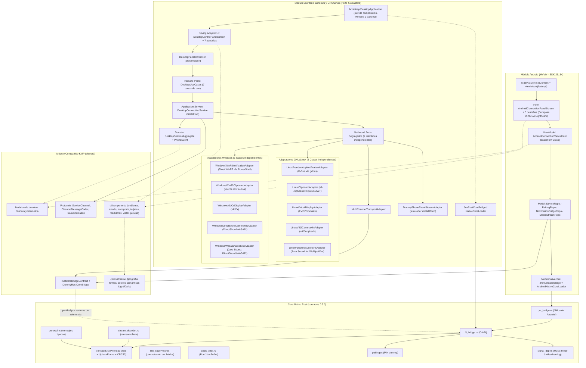
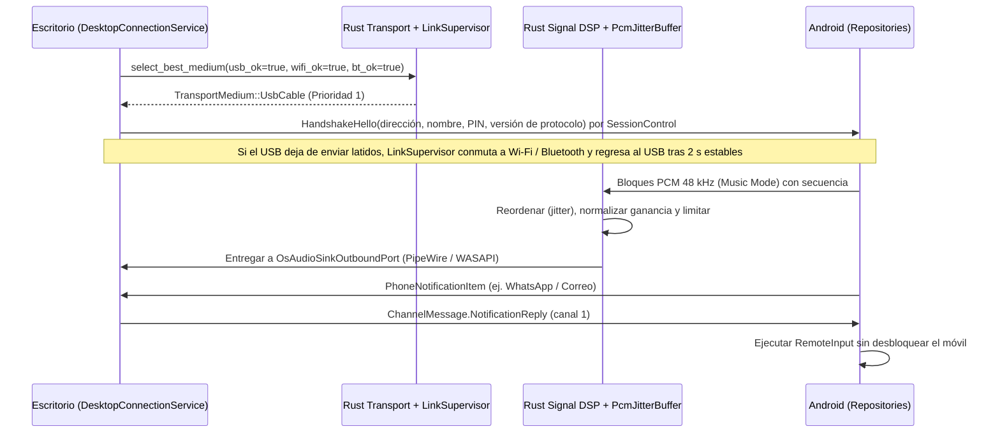

# Arquitectura de Capas e Infraestructura — UPIICSA-Connect

Este documento detalla la organización estructural de **UPIICSA-Connect**, justificando la separación de responsabilidades entre el núcleo de alto rendimiento en **Rust**, la capa común en **Kotlin Multiplatform**, la arquitectura **Ports & Adapters (Hexagonal)** en escritorio (**Windows** y **GNU/Linux**) y el patrón **MVVM** en **Android**.

> Actualizado en la intervención **IA-007** (2026-11-24).

---

## 1. Visión Global de Módulos e Infraestructura

---

## 2. Arquitectura Ports & Adapters en Escritorio (`desktopApp`)

### Regla Anti-Clases-Dios (*Anti-God-Class Policy*)
Cada capacidad del sistema operativo define un **Puerto de Salida (`Outbound Port`) propio** y exactamente **un adaptador dedicado por cada sistema operativo**:

| Puerto de Salida (`ports/outbound/OsAndTransportPorts.kt`) | Adaptador GNU/Linux (`adapters/os/linux/`) | Adaptador Windows (`adapters/os/windows/`) | Responsabilidad Única |
| :--- | :--- | :--- | :--- |
| `OsNotificationOutboundPort` | `LinuxFreedesktopNotificationAdapter` (`gdbus` → `org.freedesktop.Notifications`) | `WindowsWinRtNotificationAdapter` (toast WinRT con PowerShell `-EncodedCommand`) | Mostrar notificaciones del teléfono en el escritorio y retirarlas al resolverlas desde la PC. |
| `OsClipboardOutboundPort` | `LinuxClipboardAdapter` (`wl-clipboard`, `xclip`, `xsel` o AWT) | `WindowsWin32ClipboardAdapter` (`Win32ClipboardApi`: `user32.dll`/`kernel32.dll` vía JNA) | Leer y escribir texto en el portapapeles del sistema operativo anfitrión. |
| `OsVirtualDisplayOutboundPort` | `LinuxVirtualDisplayAdapter` | `WindowsIddCxDisplayAdapter` | Crear, redimensionar y capturar frames del monitor virtual secundario enviado a Android. |
| `OsVirtualCameraMicOutboundPort` | `LinuxV4l2CameraMicAdapter` | `WindowsDirectShowCameraMicAdapter` | Inyectar video y audio provenientes de la cámara/micrófono del móvil en dispositivos virtuales. |
| `OsAudioSinkOutboundPort` | `LinuxPipeWireAudioSinkAdapter` (prefiere el dispositivo ALSA `default` que enruta por PipeWire) | `WindowsWasapiAudioSinkAdapter` (dispositivo predeterminado) | Reproducir en la tarjeta de sonido del PC el flujo de audio de *Music Mode*. |
| `DeviceTransportOutboundPort` | `MultiChannelTransportAdapter` (simulado) / `TcpLinkTransportAdapter` (real) | `MultiChannelTransportAdapter` (simulado) / `TcpLinkTransportAdapter` (real) | Negociar el enlace priorizando **Cable USB (1ª opción)** y serializar cada carga útil como `UpiicsaFrame`. |
| `PhoneEventStreamOutboundPort` | `DummyPhoneEventStreamAdapter` (simulado) / `SocketPhoneEventStreamAdapter` (real) | `DummyPhoneEventStreamAdapter` (simulado) / `SocketPhoneEventStreamAdapter` (real) | Entregar como `Flow` los eventos del teléfono (notificaciones, portapapeles, PCM, micrófono, cámara, vsync y latidos). |

### Capas Internas del Hexágono de Escritorio
1. **Dominio (`domain/`):** `DesktopSessionAggregate` (invariantes de prioridad, transiciones de estado, bitácora, historial de portapapeles y telemetría) y `PhoneEvent` (eventos entrantes). No depende de UI, adaptadores, puertos ni Compose.
2. **Puertos (`ports/inbound/` y `ports/outbound/`):** Interfaces Kotlin puras. `DesktopUseCases` agrupa los 7 casos de uso consumidos por la interfaz (conexión, notificaciones, portapapeles, monitor, cámara/micrófono, Music Mode y observación de sesión).
3. **Aplicación (`application/DesktopConnectionService.kt`):** Implementa `DesktopUseCases`; publica el estado como `StateFlow`, codifica cada orden con `ChannelMessageCodec` y procesa los `PhoneEvent` respetando los interruptores de servicio. Las mutaciones del agregado se serializan con un `Mutex`.
4. **Adaptadores (`adapters/`):** `os/linux`, `os/windows`, `transport` (simulado y `transport/tcp` real), `process` (`ProcessRunner`: ejecución de programas externos sin shell), `simulation` (simulador del teléfono) y `nativecore` (puente JNA hacia `libupiicsa_core_rs`, con respaldo automático a `DummyRustCoreBridge`).
   - **Preferencias (`adapters/preferences/`, IA-010):** `FileDesktopPreferencesAdapter` implementa `DesktopPreferencesOutboundPort` con un archivo `ajustes.properties` en la carpeta de configuración del usuario. El interruptor de Ajustes guarda ahí el modo de enlace; `DesktopLinkMode.resolve` da prioridad a `UPIICSA_ENLACE` / `-Dupiicsa.enlace` y el cambio se aplica al reiniciar.
   - **Integración real con el S.O. (IA-009):** cada adaptador de portapapeles, notificaciones y audio tiene una fábrica `forHost()` que detecta lo disponible (sesión Wayland/X11, `gdbus` y bus de sesión, `user32.dll`, tarjeta de sonido) y, si falta, conserva los datos en memoria. `OsAdapterFactory.createPortBundle(platform, linkMode)` usa el portapapeles y las notificaciones reales solo con el enlace real, para que el teléfono virtual no sobrescriba el portapapeles del usuario. El código neutral compartido vive fuera de `os/linux` y `os/windows`: `adapters/audio/JavaSoundPcmWriter` (hilo de reproducción con cola acotada que descarta bloques atrasados), `adapters/os/AwtClipboardAccess` y `adapters/process/ExecutableLocator`. El servicio de aplicación vigila el portapapeles cada 1 s (`runClipboardWatchLoop`) y envía al teléfono solo lo copiado durante la sesión.
   - **Enlace real (`transport/tcp/`):** `TcpLinkSession` (servidor TCP en `127.0.0.1:47800`, un teléfono a la vez) es compartido por `TcpLinkTransportAdapter` (descubrimiento con `adb devices -l`, túnel `adb reverse`, envío de tramas) y `SocketPhoneEventStreamAdapter` (mensajes -> `PhoneEvent`, latidos con eco para medir latencia y `PhoneEvent.LinkClosed` al vencer los latidos o cerrarse el socket). `OsAdapterFactory.createLinkPorts` elige el par simulado o real según `DesktopLinkMode`.
5. **Presentación (`ui/`):** `DesktopPanelController` traduce gestos en llamadas a los puertos de entrada y mantiene estado local de navegación y borradores; las pantallas (`ui/screens/`) solo observan estado.
6. **Raíz de composición (`bootstrap/DesktopApplication.kt`):** Único punto que conoce `OsAdapterFactory`; crea la ventana, el ícono y la bandeja del sistema.

Las reglas anteriores se verifican automáticamente con `ArchitectureRulesTest` (Linux ↛ Windows, Windows ↛ Linux, UI ↛ adaptadores/aplicación/puertos de salida, dominio puro, aplicación ↛ adaptadores/UI y tamaño máximo de adaptadores).

---

## 3. Arquitectura MVVM en Android (`androidApp`)

1. **Model (`model/`):**
   - `AndroidDeviceRepository`: ciclo de vida de conexión (USB AOAv2/ADB prioridad 1, Wi-Fi/Bluetooth prioridad 2), serialización de saludo y portapapeles con el core, y flujos de telemetría y portapapeles entrante.
   - `AndroidPairingRepository`: deriva el PIN de emparejamiento con `RustCoreBridgeContract.derivePairingPin`.
   - `NotificationBridgeSource`: contrato común de notificaciones (activas, resolución desde la PC y flujo de nuevas). Lo implementan `AndroidNotificationBridgeRepository` (simulado, enlace real apagado) y `AndroidSystemNotificationRepository` (real).
   - `notifications/UpiicsaNotificationListenerService` + `NotificationListenerHub`: Android crea el servicio al conceder el acceso a notificaciones; el *hub* compartido del proceso lo une con el repositorio. `NotificationMapper` (puro, probado en la JVM) decide qué notificaciones se espejan, y el servicio ejecuta las resoluciones con `RemoteInput`, la acción semántica de lectura o `cancelNotification`.
   - `AndroidSystemClipboardRepository`: `ClipboardManager` real (escritura del texto de la PC y escucha de copias mientras la app está en primer plano).
   - `AndroidMediaStreamRepository`: Music Mode (cada bloque PCM pasa por el DSP del core), micrófono, cámara y receptor de monitor secundario.
   - `AndroidSocketLinkRepository`: enlace real con el ordenador (`127.0.0.1:47800` vía `adb reverse`) sobre `FrameSocketChannel`; devuelve los latidos como eco, traduce mensajes a `DesktopLinkEvent` y espeja notificaciones y portapapeles.
   - `nativecore/JniRustCoreBridge`: implementación de `RustCoreBridgeContract` sobre `libupiicsa_core_rs.so` (métodos `external` enlazados con `core-rust/src/jni_bridge.rs`, que delega en las mismas funciones de `ffi_bridge.rs`). `AndroidNativeCoreLoader.loadOrDummy()` la carga con `System.loadLibrary` y recurre a `DummyRustCoreBridge` si el APK no incluye el binario (compilaciones debug sin NDK). La fábrica del ViewModel inyecta el resultado en los repositorios, por lo que ViewModel y vistas siguen dependiendo solo del contrato.
2. **ViewModel (`viewmodel/AndroidConnectionViewModel.kt`):**
   - Expone un único `StateFlow<AndroidConnectionUiState>` (incluye pestaña activa, PIN, telemetría, niveles y bitácora).
   - Administra los `Job` de flujos de sesión y multimedia; se obtiene con `viewModels { AndroidConnectionViewModel.Factory }` (la fábrica recibe la `Application` para los repositorios del sistema) y sobrevive a cambios de configuración.
   - Con el enlace real usa las notificaciones y el portapapeles del sistema; `MainActivity.onResume` llama a `refreshSystemAccess()` para reflejar el acceso concedido en los ajustes.
3. **View (`ui/` y `MainActivity`):**
   - `AndroidConnectionPanelScreen` (encabezado, `Scaffold` y barra de pestañas) y `AndroidTabScreens` (Enlace, Avisos, Portapapeles, Multimedia, Pantalla) construidas con los componentes compartidos; no contienen lógica de negocio.

---

## 4. Core de Procesamiento en Rust (`core-rust`) y Prioridad de Transporte

---

## 5. Protocolo Binario

### 5.1 Trama `UpiicsaFrame` (cabecera fija de 16 bytes, big-endian)

| Bytes | Campo | Descripción |
| :---: | :--- | :--- |
| 0–1 | Firma | `"UC"` |
| 2 | Medio | 1 USB · 2 Wi-Fi · 3 Bluetooth |
| 3 | Canal | 1 Notificaciones · 2 Portapapeles · 3 Monitor · 4 Cámara/Mic · 5 Music Mode · 6 Control de sesión |
| 4–7 | Secuencia | `u32` incremental por sesión |
| 8–11 | Longitud | `u32`, máximo 4 MiB |
| 12–15 | CRC32 | IEEE 802.3 sobre (canal, secuencia, carga útil) |

### 5.2 Mensajes de aplicación (`protocol.rs` / `ChannelMessageCodec.kt`)
Primer byte = etiqueta; textos UTF-8 con prefijo `u16`; booleanos estrictos 0/1; sin bytes sobrantes.

| Etiqueta | Mensaje | Canal |
| :---: | :--- | :---: |
| `0x10` / `0x11` / `0x12` | Respuesta, Marcar leída, Descartar notificación | 1 |
| `0x13` | Notificación publicada en el teléfono (id, app, paquete, remitente, cuerpo, admite respuesta) | 1 |
| `0x20` | Texto de portapapeles + origen | 2 |
| `0x30` | Cámara / micrófono / cámara trasera | 4 |
| `0x40` | Music Mode + ganancia en milésimas | 5 |
| `0x50` | Saludo de enlace (dirección, nombre, PIN, versión de protocolo `u16`; actual: 1) | 6 |
| `0x60` | Latido con marca de tiempo | 6 |

### 5.3 Enlace TCP (`shared/src/jvmCommonMain/.../link/FrameSocketChannel.kt`)

Código compartido por escritorio y Android (conjunto intermedio `jvmCommonMain`). Cada mensaje se serializa con el core (`encodeFrame`) y las lecturas parciales se reensamblan con `FrameReassembler` (paridad Kotlin de `stream_decoder.rs`, validación CRC32 delegada al core). El ordenador envía `Heartbeat` cada 1 s, el teléfono lo devuelve y la latencia es la mitad del viaje redondo; sin tráfico durante 3 s el enlace se cierra. Cancelar la recolección de `incoming()` cierra el socket para liberar el hilo lector. El servidor escucha solo en loopback hasta contar con mTLS (v0.4.0). Si el saludo del otro extremo trae una versión de protocolo distinta de `PROTOCOL_VERSION`, el enlace se cierra con el motivo «Versión de protocolo incompatible».

La compatibilidad Kotlin ↔ Rust se garantiza con vectores de referencia idénticos en `core-rust/src/lib.rs`, `core-rust/src/protocol.rs` y `shared/src/commonTest/`.

---

## 6. Esquema Cromático Institucional (UPIICSA - IPN)

Definido de forma centralizada en `shared/src/commonMain/kotlin/mx/ipn/upiicsa/connect/shared/ui/theme/UpiicsaTheme.kt`:

- **Modo Claro (`Light`):**
  - Primario (Verde UPIICSA): `#006341`
  - Secundario (Oro / Amarillo UPIICSA): `#F2A900`
  - Terciario (Guinda IPN): `#6C1D45`
  - Fondo y Superficie: `#F5F8F6` / `#FFFFFF`
- **Modo Oscuro (`Dark`):**
  - Primario (Verde UPIICSA brillante para alto contraste): `#4CD99B`
  - Secundario (Oro UPIICSA cálido): `#FFD166`
  - Terciario (Guinda IPN aclarado): `#E07A9F`
  - Fondo y Superficie: `#0D1512` / `#14201B`
- **Tokens extendidos (`UpiicsaThemeTokens.extendedColors`):** éxito, advertencia, información, color por medio de enlace (USB / Wi-Fi / Bluetooth), escala del medidor de audio (verde -> oro -> guinda) y lienzo de vistas previas, en variantes clara y oscura.
- **Tipografía y formas:** `UpiicsaTypography`, `UpiicsaMonoStyle` (PIN y métricas) y `UpiicsaShapes` (esquinas de 6 a 28 dp).

---

## 7. Verificación Automatizada

| Comando | Alcance |
| :--- | :--- |
| `cargo test --manifest-path core-rust/Cargo.toml` | 24 pruebas del core (transporte, protocolo, reensamblado, supervisor, jitter, PIN y FFI). |
| `./gradlew :shared:desktopTest` | Códec y paridad de `DummyRustCoreBridge` con los vectores de Rust. |
| `./gradlew :desktopApp:buildRustCore :desktopApp:desktopTest` | Servicio de aplicación, puente JNA contra el binario real, enlace TCP en bucle local, adaptadores del S.O. con procesos y salidas de audio falsos, reglas de arquitectura y capturas PNG en `desktopApp/build/screenshots/`. Con `UPIICSA_PRUEBAS_SO_REAL=1` también prueba el portapapeles, las notificaciones y el audio reales del anfitrión (el trabajo de Windows del CI lo activa). |
| `./gradlew :androidApp:assembleDebug` | Compilación completa del APK debug (sin emulador). Con `-Pupiicsa.buildRustCore=true` compila el core con `cargo ndk` para 4 ABI e incluye `libupiicsa_core_rs.so`. |
| `bash scripts/verificar-simbolos-jni.sh <lib.so>` | Comprueba que cada `external fun` de `JniRustCoreBridge` tenga su símbolo `Java_…` exportado. |

### 7.1 Integración Continua y Liberación

| Flujo | Disparador | Trabajos |
| :--- | :--- | :--- |
| `.github/workflows/ci.yml` | Pull Request hacia `dev`/`master`, push a `dev` | Core Rust (fmt, clippy anfitrión y Android, pruebas, símbolos JNI); pruebas Kotlin en **GNU/Linux** y **Windows** contra el binario nativo; APK debug y lint. |
| `.github/workflows/release.yml` | Etiqueta `v*` (publica) o manual (solo compila) | `.deb`, `.AppImage`, `.tar.gz` (Ubuntu 22.04); `.msi`, `.zip` (Windows); APK firmado (secretos `UPIICSA_ANDROID_KEYSTORE_B64`, `UPIICSA_KEYSTORE_PASSWORD`, `UPIICSA_KEY_ALIAS`, `UPIICSA_KEY_PASSWORD`); `SHA256SUMS.txt` y liberación con notas de `CHANGELOG.md`. |

Los instaladores de escritorio empaquetan el core mediante `appResources` (tarea `stageRustCore`); en tiempo de ejecución `NativeCoreLoader` busca, en orden: `-Dupiicsa.core.lib.path` / `UPIICSA_CORE_LIB`, la carpeta `compose.application.resources.dir` y la ruta de bibliotecas del sistema.
