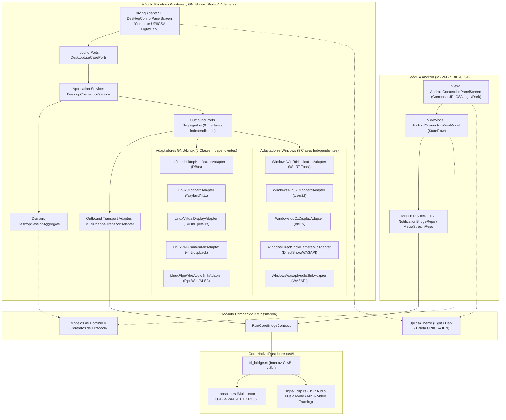
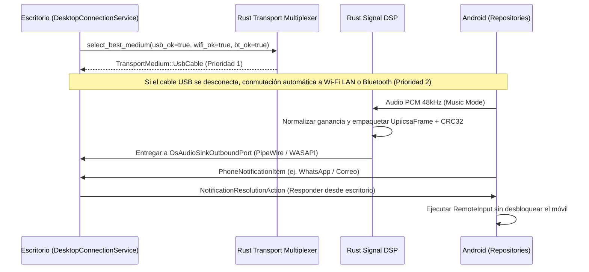

# Arquitectura de Capas e Infraestructura — UPIICSA-Connect

Este documento detalla la organización estructural de **UPIICSA-Connect**, justificando la separación de responsabilidades entre el núcleo de alto rendimiento en **Rust**, la capa común en **Kotlin Multiplatform**, la arquitectura **Ports & Adapters (Hexagonal)** en escritorio (**Windows** y **GNU/Linux**) y el patrón **MVVM** en **Android**.

---

## 1. Visión Global de Módulos e Infraestructura

---

## 2. Arquitectura Ports & Adapters en Escritorio (`desktopApp`)

### Regla Anti-Clases-Dios (*Anti-God-Class Policy*)
Para evitar concentrar llamadas del sistema operativo Windows y GNU/Linux en una única clase monolítica, cada capacidad del sistema operativo define un **Puerto de Salida (`Outbound Port`) propio** y exactamente **un adaptador dedicado por cada sistema operativo**:

| Puerto de Salida (`ports/outbound/OsAndTransportPorts.kt`) | Adaptador GNU/Linux (`adapters/os/linux/`) | Adaptador Windows (`adapters/os/windows/`) | Responsabilidad Única |
| :--- | :--- | :--- | :--- |
| `OsNotificationOutboundPort` | `LinuxFreedesktopNotificationAdapter` | `WindowsWinRtNotificationAdapter` | Mostrar notificaciones del teléfono y capturar acciones/respuestas rápidas del usuario en el escritorio. |
| `OsClipboardOutboundPort` | `LinuxClipboardAdapter` | `WindowsWin32ClipboardAdapter` | Leer y escribir texto en el portapapeles del sistema operativo anfitrión. |
| `OsVirtualDisplayOutboundPort` | `LinuxVirtualDisplayAdapter` | `WindowsIddCxDisplayAdapter` | Crear, redimensionar y capturar frames del monitor virtual secundario enviado a Android. |
| `OsVirtualCameraMicOutboundPort` | `LinuxV4l2CameraMicAdapter` | `WindowsDirectShowCameraMicAdapter` | Inyectar video y audio provenientes de la cámara/micrófono del móvil en dispositivos virtuales para videollamadas. |
| `OsAudioSinkOutboundPort` | `LinuxPipeWireAudioSinkAdapter` | `WindowsWasapiAudioSinkAdapter` | Reproducir en la tarjeta de sonido del PC el flujo de audio de *Music Mode* con latencia mínima. |
| `DeviceTransportOutboundPort` | `MultiChannelTransportAdapter` (compartido sobre `core-rust`) | `MultiChannelTransportAdapter` (compartido sobre `core-rust`) | Negociar enlace priorizando **Cable USB (1ª opción)** y respaldando en **Wi-Fi / Bluetooth (2ª opción)**. |

### Capas Internas del Hexágono de Escritorio
1. **Dominio (`domain/DesktopSessionAggregate.kt`):** Contiene las invariantes de negocio puras (por ejemplo, que el cable USB siempre prevalece en prioridad automática sobre canales inalámbricos y la validación de estados activos de los servicios). No depende de UI, redes ni librerías del sistema operativo.
2. **Puertos (`ports/inbound/` y `ports/outbound/`):** Interfaces Kotlin puras que aíslan la aplicación tanto de la interfaz Compose como de los detalles de Windows/Linux y Rust.
3. **Aplicación (`application/DesktopConnectionService.kt`):** Implementa los 6 casos de uso de entrada orquestando llamadas entre el agregado de dominio, el transporte y el adaptador del S.O. inyectado por `OsAdapterFactory`.
4. **Adaptadores (`adapters/`):** Contienen el código específico de plataforma y el enlace con el núcleo Rust.
5. **Interfaz Gráfica (`ui/DesktopControlPanelScreen.kt`):** Actúa exclusivamente como *Driving Adapter* invocando los puertos de entrada.

---

## 3. Arquitectura MVVM en Android (`androidApp`)

1. **Model (`model/`):**
   - `AndroidDeviceRepository`: Administra el ciclo de vida de conexión (USB AOAv2/ADB como prioridad 1, Wi-Fi/Bluetooth como prioridad 2) y la lectura/escritura del `ClipboardManager`.
   - `AndroidNotificationBridgeRepository`: Se enlaza conceptualmente con `NotificationListenerService` para capturar notificaciones entrantes y ejecutar acciones `RemoteInput` (responder, marcar como leído, descartar) cuando el usuario las resuelve desde la PC.
   - `AndroidMediaStreamRepository`: Orquesta el envío de audio en *Music Mode* (`AudioPlaybackCapture`), la captura de cámara/micrófono para videollamadas en el portátil y la recepción de frames de video cuando el teléfono o tablet funciona como monitor secundario.
2. **ViewModel (`viewmodel/AndroidConnectionViewModel.kt`):**
   - Expone un único estado reactivo inmutable `StateFlow<AndroidConnectionUiState>`.
   - Procesa las acciones de la UI sin mantener referencias a vistas ni contextos Android visuales.
3. **View (`ui/AndroidConnectionPanelScreen.kt`):**
   - Panel Compose declarativo que solo observa el `StateFlow` del ViewModel y delega eventos del usuario hacia métodos del ViewModel.

---

## 4. Core de Procesamiento en Rust (`core-rust`) y Prioridad de Transporte

---

## 5. Esquema Cromático Institucional (UPIICSA - IPN)

Definido de forma centralizada en `shared/src/commonMain/kotlin/mx/ipn/upiicsa/connect/shared/ui/theme/UpiicsaTheme.kt`:

- **Modo Claro (`Light`):**
  - Primario (Verde UPIICSA): `#006341`
  - Secundario (Oro / Amarillo UPIICSA): `#F2A900`
  - Terciario (Guinda IPN): `#6C1D45`
  - Fondo y Superficie: `#F5F8F6` / `#FFFFFF`
- **Modo Oscuro (`Dark`):**
  - Primario (Verde UPIICSA brillante para alto contraste): `#4CD99B`
  - Secundario (Oro UPIICSA cálido): `#FFD166`
  - Terciario (Guinda IPN aclarado): `#E07A9F`
  - Fondo y Superficie: `#0D1512` / `#14201B`
